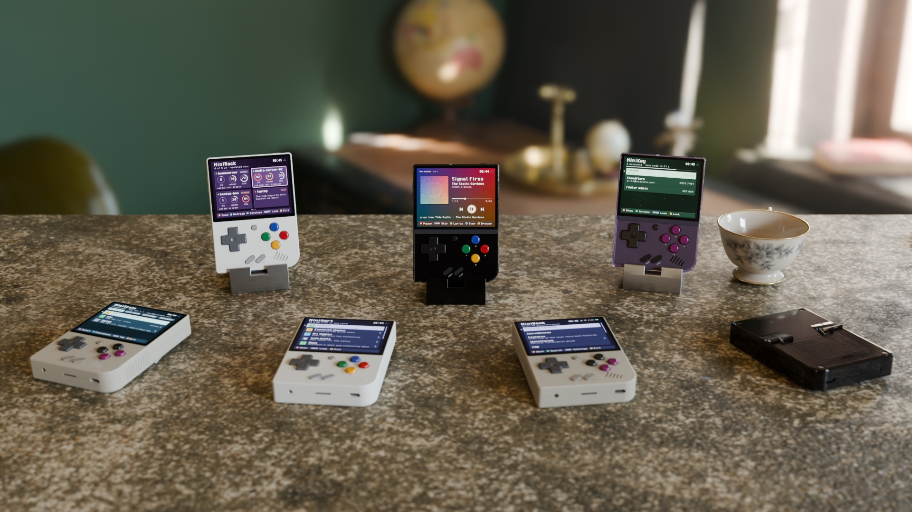
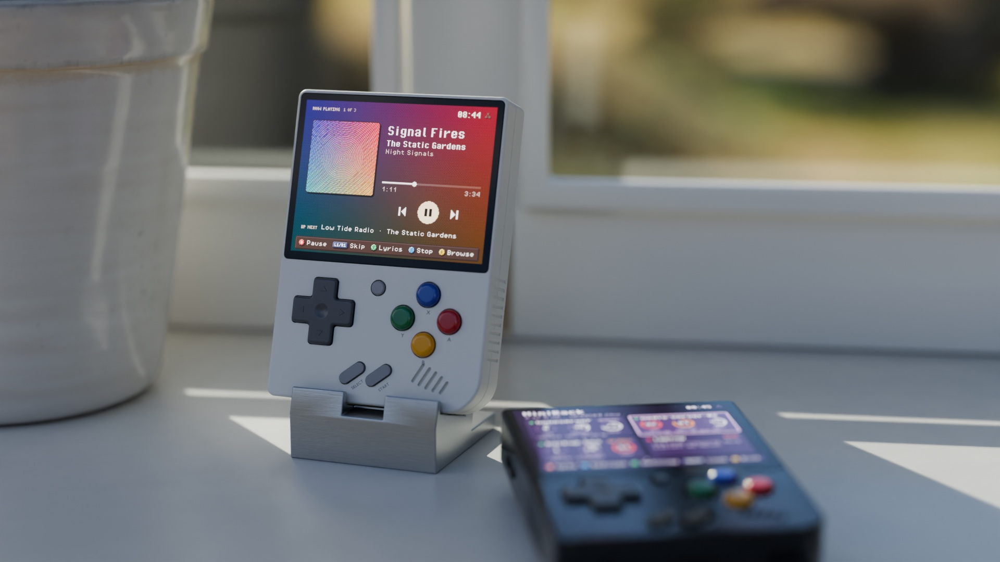

# MiniDeck

Apps for the Miyoo Mini Plus on Onion OS: a Tailscale, Headscale, WireGuard
and NetBird client, your servers' stats, music from your own server, 2FA
codes, an app store and more. They share one pixel-art interface with 16
themes and animated backgrounds, keep logins on the card only encrypted, and
reach your private network through MiniScale.

| App | |
|---|---|
| [MiniScale](https://github.com/zakijss/MiniScale) | Puts the Miyoo on your private network: Tailscale or your own Headscale (devices, exit nodes, Taildrop, QR login), a plain WireGuard server, or NetBird (unofficial client) |
| [MiniRack](https://github.com/zakijss/MiniRack) | Live CPU, memory, disk and temperature from Glances, Beszel or Vantage |
| [MiniTape](https://github.com/zakijss/MiniTape) | Navidrome and Subsonic music that keeps playing in the menu and other apps |
| [MiniFin](https://github.com/zakijss/MiniFin) | Jellyfin movies and shows with hardware video decoding, Quick Connect and downloads (unofficial client) |
| [MiniKey](https://github.com/zakijss/MiniKey) | 2FA codes, locked with a code pressed on the buttons |
| [MiniTop](https://github.com/zakijss/MiniTop) | What's running and what starts at boot; keeps the clock right |
| [MiniMart](https://github.com/zakijss/MiniMart) | Themes, icon packs, apps and homebrew games, checked before installing |
| [MiniBook](https://github.com/zakijss/MiniBook) | The Onion OS documentation, readable offline |
| [MiniRadar](https://github.com/zakijss/MiniRadar) | The devices on your Wi-Fi, and Wake-on-LAN |
| [MiniPulse](https://github.com/zakijss/MiniPulse) | Latency, download and upload over Wi-Fi |

## Install

- **Every app:** download [minideck-all.zip](https://github.com/zakijss/MiniDeck/releases/latest/download/minideck-all.zip),
  unzip it onto the root of the SD card, and restart the Miyoo.
- **One app:** download its zip from its repository's releases, or install
  [MiniMart](https://github.com/zakijss/MiniMart) and pick it from **Apps**.
  MiniMart also keeps the apps up to date.

Updates keep your settings and logins. **SELECT** on an app's home screen
opens Appearance, where the theme and background are chosen for all the
apps at once.

## Compatibility

Built and tested on a Miyoo Mini Plus with Onion OS 4.4. Stock firmware,
MinUI, muOS, Allium, Koriki and other Miyoo models aren't supported; the
Mini v2 to v4 run Onion on the same chip but are untested.

## This repository

The Go library the apps share (`github.com/zakijss/minideck`: the
interface, themes, tailnet access, encrypted secrets), the app icons,
development tools, and the release that bundles every app with MiniMart's
catalogue. [docs/DEVELOPMENT.md](docs/DEVELOPMENT.md) covers building and
contributing to any of the repositories.

## License

[MIT](LICENSE). Third-party components are listed in [NOTICE](NOTICE).
MiniScale is not made or supported by Tailscale Inc. or NetBird GmbH. WireGuard is a registered trademark of Jason A. Donenfeld. MiniDeck and its apps are independent projects, not made by or affiliated with Miyoo; Miyoo Mini Plus is named only to say which device they run on.
